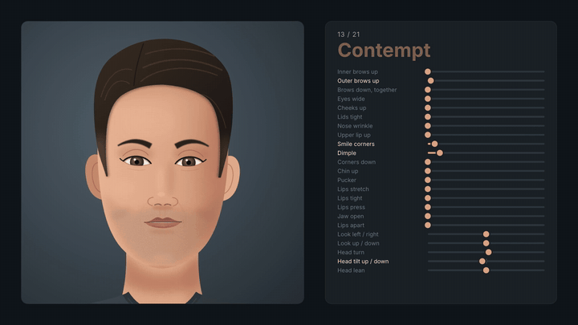

# Super Karen

A cartoon face that acts, made of nothing but code. Claude Code drew her and built her.



[](https://www.youtube.com/watch?v=cIWPgXm5TEU)

- One hand-built SVG face. No images, no AI image model.
- Face muscles from FACS, the system psychologists use to read faces. Each one is a slider, left and right apart.
- 27 expressions, each a mix of those muscles: a faint fake smile, a real one, furious, evil, grieving.
- She blinks, breathes and glances on her own.
- She lip-syncs a song and reacts to a narration, word by word.
- Rendered to MP4 with [HyperFrames](https://hyperframes.heygen.com).

## Make her yours with Claude Code

Paste this into [Claude Code](https://claude.com/claude-code):

```
Clone https://github.com/dangskipperms/superkaren, get Super Karen running for me, then help me make her my own.
```

The repo carries a `CLAUDE.md`, so Claude knows the face, the tools and the rules of the motion from the start.

## Or by hand

You need Node 22+ and ffmpeg.

```
git clone https://github.com/dangskipperms/superkaren
cd superkaren
npm run dev
```

- Render her expressions: `npx hyperframes render . -c compositions/karen-sliders.html`
- Render her music video: `npx hyperframes render . -c compositions/manager.html`
- Play with her muscles in a browser: open `drawings/adult-host.html`

## What is inside

| Path | What it is |
|---|---|
| `host/` | Super Karen: her muscles, expressions, mouth shapes and life |
| `compositions/karen-sliders.html` | Every expression, with its muscle sliders |
| `compositions/manager.html` and `film/manager/` | Her music video |
| `drawings/adult-host.html` | The drawing she came from |
| `rig/`, `index.html`, `compositions/talk.html` | Pip, the kid head that came before her |
| `tools/` | Lip-sync and reaction timing from any voice or song |

## License

MIT. Take her, change her, show what you make.
